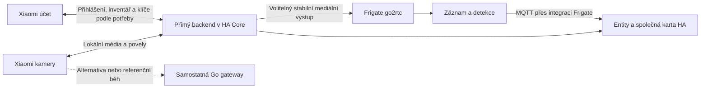

# Přímá integrace Xiaomi kamer do Home Assistantu

Plán z 16. 11. 2026. Popisuje cílové řešení a podmínky vydání. Výsledky dosavadních zkoušek patří k režimu s Go gateway a jsou zaznamenané v [přehledu přejímek](LOCAL-CAMERA-PROGRESS.md).

Přímá integrace se v Home Assistantu jmenuje **Xiaomi Camera Direct**. Stávající přímá položka používá původní interní doménu `xiaomi_direct_pilot`, aby se při přejmenování zachovaly entity a dashboard. Přechod z externího režimu `xiaomi_local_gateway` zůstává samostatným úkolem D2.

Aktuální fyzický stav k 20. 11. 2026: uživatel potvrzuje přímý živý obraz na C201, C400, C701 a Mi 360; AW300 zůstává k pozdějšímu ověření. Fyzický pohyb PTZ je uživatelem ověřený na C201, C400 a C701. Starší síťové sondy a 503 v [záznamu přejímek](HA-DIRECT-PILOT.md) zachycují dřívější okamžiky a tento aktuální stav nepřebíjejí.

HA integrace má QR autorizaci, výběr kamer, obnovu přihlášení, přímý stream, snímek, krátký záznam, směrové PTZ a společný kontrakt backendů. Simulované HA regrese pokrývají životní cyklus médií, přepnutí gateway/direct a ztrátu/obnovení trasy při změně IP se zachováním `entity_id` a obnovením streamu (pět testů, `OK`; log je v přehledu přejímek). Fyzicky jsou doložené JPEG a MP4 z C201 a oba rozlišené profily C400. C201 audio se podařilo dekódovat na testovací stanici, ale přehrání ve WebRTC/MSE kartě potvrzené není. C701 má nyní experimentální, opt-in příjem zvuku do HA a hovor z HA přes podržení tlačítka; nové regresní a fyzické ověření těchto cest zůstává otevřené. Fyzická obnova po výpadku a dlouhodobá stabilita zůstávají otevřené. D3 dál zahrnuje modelovou matici a stabilitu AW300; D4 je živé Frigate ověření a D5 další funkce a vydání.

Verze 0.2.1 přidává z F03 volbu nižšího a plného rozlišení pro C400 v regionu DE. Obě rozlišení jsou ověřená na fyzické kameře přes přímou integraci a živou kartu testovacího HA. [Výsledky přejímky](HA-DIRECT-PILOT.md#volba-rozlišení-c400-f03)

F02 nabízí volitelný poslech C201 v regionu DE. Od verze 0.2.3 se Opus i G.711 převádí na AAC v HA a sdílí s videem jednu kamerovou relaci. Přímá metadatová sonda na fyzické C201 potvrdila Opus. [Záznam zkoušek](HA-DIRECT-PILOT.md#zvuk-z-c201-f02)

## 1. Výsledek pro uživatele

- V HA OS i HA Container uživatel nainstaluje vlastní integraci, v **Nastavení → Zařízení a služby** přidá Xiaomi kamery, propojí účet v příslušném regionu a vybere kamery. Přímý režim nevyžaduje URL gateway, ručně získaný token, další doplněk ani další kontejner.
- HA vytvoří zařízení a entity. Společná karta zobrazí živý obraz a ovládání nad videem podle skutečných schopností každé kamery. Automatizace používají entity a služby HA. Kamery spárované v Xiaomi Home, pro které zatím nemáme funkční profil, jsou vidět s vysvětlením.
- Frigate je volitelné. Má na starosti detekci a dlouhodobý záznam, zatímco Xiaomi integrace obsluhuje účet a ovládání kamer. Data z Xiaomi účtu se do Frigate nezadávají.
- Go gateway zůstane samostatně sestavitelná pro diagnostiku, referenční testy, provoz bez HA a pro nasazení, kde má záznam pokračovat i při restartu HA Core. Stávajícím uživatelům přepnutí nabídne průvodce.

## 2. Architektura

### Rozhraní a knihovna

1. Zachovat doménu `xiaomi_local_gateway`, uživatelské entity, společnou kartu a vzory akcí. Zavést malé interní rozhraní pro inventář, schopnosti, otevření/zavření streamu, PTZ a další funkce až podle potřeby. Stávající `GatewayClient` zapojit jako adaptér pro externí režim. Oba backendy musí projít stejnými kontraktovými testy entit. Výběr backendu patří do nastavení integrace. Pokud se účetní DID liší od dosavadního ID gateway, průvodce nabídne mapování na existující kameru; při návratu zůstává URL a token v datech téže položky.
2. Přímý backend postavit jako samostatně testovatelnou asynchronní Python knihovnu bez závislosti na HA. Jako referenci použít Go implementaci MISS/CS2, profily, normalizované výsledky a existující regresní případy. Nejprve ověřit existující knihovny na přesných modelech a licencích. Pokud vhodná knihovna pokrývá jen část, doplnit chybějící části s doloženým původem kódu a zachovanými licenčními oznámeními. Závislost připnout na vydanou verzi.
3. Python je výchozí varianta. Nativní modul má smysl posoudit jen pokud funkční prototyp narazí na měřitelný výkonový limit nebo nutnou knihovnu. V takovém případě vyžadovat testované balíčky pro Python a platformy podporovaných verzí HA, alespoň Linux amd64 a aarch64, reprodukovatelný build a instalaci bez kompilátoru, rootu a ruční instalace binárek. Pokud žádná varianta neprojde, ponechat přímý režim experimentální a zdokumentovat konkrétní blokátor.
4. Nepřepisovat celý Go backend najednou. Začít jednou C201 a svislým řezem od inventáře po dekódovaný snímek a uvolnění relace. Pomocí stejného kontraktu potom rozšiřovat funkce a modely. Profil vést podle modelového ID, doloženého firmwaru a regionu, po jednotlivých schopnostech. Přidat kontrolu rozdílů profilů Go a Python pro podporované průniky.

### Životní cyklus a média

- Jeden vlastník lokální transportní relace na vybranou kameru a potvrzený kanál. Živý obraz, snímek, HA záznam, PTZ a Frigate sdílejí aktivní relaci, kdykoli to prokazatelně umožňuje stejný kanál. Stavový automat sloučí souběžná otevření, čeká na první dekódovatelné médium, omezuje fronty a odpojuje pomalé odběratele bez vlivu na ostatní. Chyba spojení spouští omezené opakování s prodlevou jen při aktivním odběru. Odhlášení posledního klienta ukončí opakování. Při potvrzeném zapnutí režimu soukromí nebo vyřazení kamery se relace hned zavře a nepřijímá další požadavky po dobu tohoto stavu.
- Ověřit mediální adaptér proti veřejnému rozhraní [HA Camera](https://developers.home-assistant.io/docs/core/entity/camera/) a proti FFmpeg/PyAV v cílovém HA. První kandidát je lokální RTSP zdroj přes prověřenou knihovnu s omezeným přístupem v rámci procesu či prostředí HA. HA z něj získá `stream_source`, JPEG a HLS. Nativní WebRTC přidat jen přes podporované rozhraní, pokud vyřeší prokázaný problém latence nebo kompatibility. Výsledkem prvního prototypu bude výběr mediálního adaptéru, nikoli závazek napsat vlastní RTSP server. Dynamické cesty, které dnes přiděluje Go relay, jsou použitelné pro interní přehrávání podle jeho kontraktu, ale samy o sobě nesplňují Frigate požadavek na stabilní URL.
- Před první relací ověřit zdrojovou adresu, trasu, rozhraní a schválenou kamerovou podsíť. Odpověď musí pocházet od očekávané kamery. Zakázat fallback na WAN/relay pro média, neočekávané cíle a otevření mimo vybranou kameru. Přihlašování, inventář a získání klíčů mohou používat cloud. Zvlášť ověřit chování existujícího streamu a nového připojení při výpadku cloudu. Nevyžadovat pro HA OS privilegovaný režim. Pokud současný mechanismus výběru rozhraní vyžaduje oprávnění, ověřit bezpečnou alternativu v běžném HA runtime, včetně více síťových rozhraní a změny IP.
- Enumerace zařízení, běžný poll a zjišťování schopností HA nesmějí startovat video. Inventář a pomalé údaje číst sdíleně po účtu. Při vypnutí integrace zrušit úlohy, volající požadavky a sockety, zavřít export i mediální relace a ověřit absenci duplicitních listenerů po znovunačtení. Blokující práci přesunout mimo smyčku HA a měřit ji při souběhu kamer. [Pravidla pro blokující operace v HA](https://developers.home-assistant.io/docs/asyncio_blocking_operations/)

### Nastavení účtu a migrace

- Průvodce `config_flow` ověří funkční způsob autorizace pro EU účet, region, seznam všech dostupných kamer a volbu zařízení. Do základní instalace zahrnout také opětovné přihlášení po vypršení nebo odvolání relace, změnu výběru a čitelné chyby pro chybný region, prázdný účet a nedostupnou kameru. Vícefaktorové či jiné ověření účtu je součástí zkoušky proveditelnosti. Použít dokumentovanou autorizaci, pokud je dostupná, a doložit funkční a udržitelný tok před vydáním. Úspěch s dříve připraveným účtem z Vieweru sám o sobě průvodce nepotvrzuje. [Config flow v HA](https://developers.home-assistant.io/docs/core/integration/config_flow/)
- Identitu účtu opřít o stabilní ID účtu a region. Párovat zařízení podle stabilního ID kamery; IP, názvy a URL jsou měnitelné. Při přechodu upravit existující položku a zachovat `device_id`, `entity_id`, oblasti, historii, automatizace a kartu. Kde se identita téhož zařízení prokazatelně nedá spárovat nebo koliduje, nabídnout mapování uživateli. U více účtů ověřit izolaci i situaci sdílené kamery.
- Nejdřív provést kontrolu dostupnosti a shody inventáře ve zkušební položce bez aktivních médií. Přepnutí provést s možností návratu ke stávajícímu URL/token režimu, včetně zachování nastavení a stejné sady entit. Nedovolit dvěma backendům automaticky otevřít tutéž kameru. Záznam může při přepnutí zaznamenat výpadek, který se změří.
- Přístupové údaje držet v soukromé konfiguraci HA se standardní ochranou přístupu a záloh. Surové tokeny, hesla, klíče, URI s přihlašovacími údaji ani video nesmějí být v diagnostice, reportech, exportech nebo stavech entit. Otestovat redakci běžných i chybových odpovědí a výjimek.

## 3. Frigate

| Varianta | Tok obrazu a použití |
| --- | --- |
| HA bez Frigate | Přímý backend → nativní kamera HA. Obraz podle potřeby, snímek a krátký záznam přes HA. |
| Přímá integrace s Frigate | Přímý backend → lokální chráněný vstup go2rtc ve Frigate → záznam a detekce. Živá karta může používat zdroj HA nebo kompatibilní restream Frigate; PTZ a nastavení zůstávají v Xiaomi integraci. |
| Frigate má nahrávat i při restartu HA | Samostatná Go gateway → Frigate. Stejné zařízení v HA používá vzdálený režim. Při běhu Frigate na samostatném stroji tím záznam přežije i restart hostitele HA, pokud gateway, Frigate, kamera a síť zůstanou dostupné. |

- Export je ve výchozím stavu vypnutý. První kandidát je stálý RTSP název zdroje pro každou vybranou kameru s výslovným zapnutím, autentizací a omezením na rozhraní/síť Frigate. Ověřit podporu z konkrétního Frigate kontejneru i odděleného hostu, rotaci přístupových údajů, žádný přístup mimo povolenou cestu a obnovu po změně relace. Pokud nelze výstup bezpečně zpřístupnit v běžném HA OS, Frigate export se nevydá jako stabilní a pro dané nasazení se použije oddělený backend. Zdroj HA HLS není plánovaný dlouhodobý vstup Frigate.
- Jedno jméno v go2rtc a stejné jméno kamery ve Frigate. Pro `detect` i `record` použít stejný stream, dokud není ověřen samostatný substream a jeho dopad. Pro kompatibilní kodek zachovat záznam bez překódování. H.264 pro prohlížeč vytvářet podle potřeby a měřit náklady jedné sdílené konverze. Nevytvářet duplicitní připojení ke kameře pro každý výstup. [Restream](https://docs.frigate.video/configuration/restream/) · [go2rtc a konverze](https://docs.frigate.video/configuration/go2rtc/)
- Rozšířit konfigurátor nebo dokumentovaný export o vybrané managed kamery a stabilní adresy. Dosavadní `/v1/frigate/config` čte statický seznam a u managed režimu tuto úlohu neplní. Přihlašovací údaje v ukázce zastoupí reference na lokální secrets. Frigate připojit k HA přes jeho integraci a společný MQTT broker, ověřit skutečné detekce, záznamy, mapování jmen, dostupnost a obnovu. Frigate PTZ/autotracking řešit samostatně až po ověření potřebného ONVIF rozhraní a pohybu na daném modelu. [Frigate v HA](https://docs.frigate.video/integrations/home-assistant/)
- Přímý režim při zastavení HA Core přeruší zdroj Frigate. Přejímka měří dobu výpadku a automatické obnovení záznamu. Vyžaduje-li uživatel záznam i během restartu HA, je Go gateway podporovaná provozní volba, ne skrytý fallback.

## 4. Pořadí implementace

[Matice funkcí a pravidla pro nové kamery](HA-CAMERA-CAPABILITIES.md) platí pro všechny modely. Chybějící ověření se eviduje jako práce k dokončení.

Pro aktuální živé zkoušky používáme C701 (`chuangmi.camera.079ae2`). Pokrytí ostatních modelů zůstává v regresích a jejich fyzická přejímka má vlastní stav. Vstup do testovacího HA a zacílení preflightu jsou v [provozních poznámkách](HA-TEST-ENV.md).

| Etapa | Změna a výstup | Podmínka dokončení |
| --- | --- | --- |
| D0 – reference | Zaznamenat funkce a přesné verze z posledních testů gateway. Vyčlenit kontrakty, anonymizované deterministické testovací případy, soupis licencí a zvolit testovací HA OS přímo na kamerové LAN. | Go baseline a verze HA dohledatelné; síťový preflight potvrdí potřebnou cestu nebo ukáže konkrétní blokátor. |
| D1 – proveditelnost | C201 bez gateway: autorizovaný inventář, místní spojení, dekódovaný snímek v HA, ukončení a nové otevření. Posoudit autentizaci pro nový účet a balení na amd64/aarch64. | Jeden opakovatelný přímý tok v běžném HA OS bez gateway a bez ručně instalované binárky. Zdokumentované použití služeb Xiaomi. Výsledky jen z mocku nebo WSLc tuto etapu neuzavírají. |
| D2 – HA beta | Společné rozhraní a dva backendy, config flow, reauth, výběr, migrace a návrat, uvolňování zdrojů. Živá karta, snímek, krátký záznam a bezpečný krokový PTZ podle ověřených schopností. | Mock E2E s oběma backendy a fyzická C201 s videem, snímkem, záznamem, ovládáním a obnovou. HA-only beta se označí rozsahem C201. |
| D3 – matice kamer | Přidat Mi 360, C400 a AW300. Ověřit souběh, profily, H.264/H.265, modelové ovládání a browserové klienty. | Každá ověřená kombinace má vlastní řádek v matici a reprodukovatelný výsledek. Nestabilní model zůstává experimentální. |
| D4 – Frigate | Bezpečný stabilní export, mapování jmen, volitelný restream v HA, detekce, záznam, MQTT a obnova. | Skutečný Frigate s fyzickými kamerami, přehratelný záznam a událost ve správné HA entitě, ověřený počet relací, záznam po výpadku znovu nabíhá. |
| D5 – funkce a vydání | Rozšiřovat jednotlivé schopnosti, sepsat podporu per model, HACS instalaci, migraci a rollback. Přejmout čisté HA OS i HA Container, sledovat 24 h stabilitu. | Povinná matice je zelená pro deklarovaný rozsah; všechny čtyři kamery lze uvést jako podporované až po jejich vlastní přejímce. Omezení funkcí jsou vidět v HA a v dokumentaci. |

D4 lze prototypovat už s C201 po D1, aby se včas ověřil export. [Handoff F01–F12 a M01–M07](LOCAL-CAMERA-HANDOFF.md) zůstává seznamem funkcí a dalších modelů. Pro přímý režim se každá funkce přejímá zvlášť. Po videu, JPEG, HA záznamu a čtyřech směrech pohybu následují audio a kvalita, noční režim a indikátor, soukromí, stav/kapacita SD, index a přehrání SD klipů, presety/limity/zoom a tracking, obousměrné audio a ostatní modelové funkce. Funkci s doloženým mapováním a implementací lze nabídnout jako experimentální do dokončení přejímky. Funkce známé pouze ze specifikace zůstávají v matici k doplnění. Fyzický AW300 je pevná kamera, PTZ se pro ni nepřejímá.

Pro vydání nejdřív vyzkoušet novou instalaci a přechod na kopii testovací konfigurace. Přechod ověřit podle chování dashboardu i existující automatizace, ne pouze podle jmen entit. Při selhání přihlášení, ztrátě identity entity, nefunkčním obrazu nebo neobnoveném záznamu použít návrat v průvodci a ověřit, že znovu běží původní zdroj. Chování po aktualizaci integrace a návrat k původní verzi popsat v návodu k vydání.

## 5. Testovací plán

| Sada | Co prokazuje | Jak často |
| --- | --- | --- |
| Rychlá offline | Oba backendy proti stejnému kontraktu; inventář včetně neznámé kamery, region/profil/schopnosti, žádné video během pollu, fake čas a limity retry, jeden start při souběžném odběru, odpojení pomalého klienta, PTZ routing, anonymizace, uvolnění socketů a front. Stávající Go a Node regresi použít pro změny těchto částí. | U dotčeného kódu při každé změně. Cíl do 60 s se zahřátou cache. |
| Porovnání s Go | Deterministické vstupy pro parser média, změnu kodeku/rozlišení, přerušení přenosu, inventář, chybové kódy a modelové povely. Porovnat normalizovaný stav a dekódovaný výstup. Při fyzickém porovnání zkoušet oba backendy postupně za stejných podmínek. | Při změně protokolu, profilu nebo normalizace. |
| Izolované HA E2E | Čistý HA, instalace a skutečný formulář, úspěšné setup/reload/unload, reauth, migrace a návrat bez duplicit, ověřené identifikátory, restart, karta, JPEG a přehratelné HLS/MP4. Přímý běh s vynechaným gateway kontejnerem a povolenými jen simulátory účtu a kamer. Stávající gateway E2E samostatně. | Při změně integrace nebo mediálního adaptéru. |
| Fyzická HA přejímka | HA OS na kamerové LAN, dále HA Container na nativním Linuxu. Dekódovat obraz a potvrdit skutečný náhled, ovládání, snímek a záznam. Zachytit evidenci skutečné lokální datové trasy, výpadku sítě/kamery/cloudu, obnovení relace, přechodu IP a chování po restartu HA. V prohlížeči běží společná karta, vzájemně se neblokují. | Jedna časově omezená zkouška na relevantní model/změnu; kompletní běh před vydáním. |
| Frigate živě | Skutečný Frigate a MQTT, souběh HA a `detect`/`record`, přehrání segmentu, detekce pohybu/objektu s potvrzením v HA, ochrana exportu, výpadek HA i Frigate nezávisle, restart kamery, oprávnění a zachování stabilní adresy. | Při změně exportu nebo Frigate konfigurace a před vydáním dané funkce. |
| Zátěž a balení | 30 min všechny ověřené kamery souběžně, 24 h s Frigate nebo bez něj podle konfigurace vydání. Kontrola CPU, RSS, sítě, latence, počtu úloh/socketů a rozlišení. Čistá instalace i upgrade na slíbených architekturách, připnutá minimální a aktuální podporovaná verze HA. | Kandidát na vydání a zásadní změna médií. |

Povinné negativní případy pro E2E: neplatná autorizace, jiný účet/region, IP mimo schválenou síť, poškozená nebo opožděná zpráva, otevřené spojení bez média, změna IP, ztráta socketu při souběžném odběru, cizí požadavek na export a reload během živého přehrávání. Nedoručený PTZ povel se nesmí po obnově znovu odeslat. Výpadek jedné kamery nesmí zastavit ostatní. Pro Frigate vedle obou restartů ověřit, že změna hesla zastaví starý přístup a po nové autorizaci vznikne nový přehratelný segment.

### Fyzické minimum a měřitelné cíle

| Model | Aktuální přímá evidence (20. 11. 2026) | Zbývající přímý test |
| --- | --- | --- |
| C201 `xiaomi.camera.c201` | Uživatel potvrzuje živý obraz a fyzický pohyb PTZ. Dříve fyzicky ověřené JPEG/MP4. | Fyzická obnova streamu po výpadku a delší stabilita. |
| Mi 360 `chuangmi.camera.026c02` | Uživatel potvrzuje živý obraz. [Následný izolovaný gateway/konzolový běh](LOCAL-CAMERA-PROGRESS.md#mi360-one-left-isolated-run-2026-11-15) poslal jeden krok doleva a obrazový posun odpovídal pohybu; to nepotvrzuje PTZ přímé integrace. | Fyzicky ověřit PTZ přímé integrace a další směry; obnova a souběh s C201/C400. |
| C400 `chuangmi.camera.039a04` | Uživatel potvrzuje živý obraz a fyzický pohyb PTZ. Nízký 864×480 a plný 2560×1440 profil byly dříve fyzicky přehrány. | Fyzická obnova po výpadku a delší stabilita. |
| C701 `chuangmi.camera.079ae2` | Uživatel potvrzuje živý obraz a fyzický pohyb PTZ. | Opakovatelnost studeného startu, obnova a dlouhodobý běh. |
| Outdoor AW300 `mxiang.camera.mod13` | Stream čeká na pozdější ověření. Starší běh jednou dekódoval obraz, následné pokusy nedodaly první médium. | Porovnat se současným náhledem Xiaomi Home a gateway; provést několik startů, stabilní běh a obnovu na konkrétním firmwaru. |

- Navržené výchozí limity pro stabilní LAN: prvních **5 startů z 5** na model, první dekódovaný snímek do **15 s** v každém pokusu, **10 minut** dekódovaného obrazu na model a **30 minut** společné karty se souběžným postupem videa. Snímek musí jít dekódovat, MP4 musí obsahovat přehratelné video v dohodnuté toleranci délky a PTZ musí způsobit očekávaný fyzický pohyb bez pohybu jiné kamery. Samotný HTTP úspěch nestačí. Zvolený prohlížeč a podporované kodeky zapsat do výsledku.
- Pro řízený výpadek měřit čas od návratu kamery, sítě nebo HA do provozu. Navržený limit je **60 s** do dekódovaného obrazu bez ruční obnovy stránky a **90 s** do nového přehratelného segmentu Frigate. Po posledním odběrateli se relace uvolní v dokumentované době nejvýše **30 s**. Souběžný záznam, dashboard a snímek nepřidají další relaci na stejném kanálu. Volitelný substream má vlastní explicitní limit.
- Vydávací běh **24 h** musí skončit bez pádu, neobnoveného streamu, opakovaného přihlašování nebo rostoucího počtu úloh a socketů. Na stejném hardwaru porovnat CPU a RSS s Go referencí při stejné kvalitě a počtu odběratelů, samostatně změřit dopad překódování. Po D1 zapsat rozpočet zdrojů a případné odůvodněné úpravy limitů ještě před sérií vydávacích testů. Výkon z WSLc nebo mocku nelze převzít jako limit cílového zařízení.

### Provedení a evidence

- Dnes existuje rychlá gateway sada `./scripts/test-camera-quick.ps1` (Linux: `sh scripts/test-camera-quick.sh`), izolovaný gateway + HA runner `./scripts/test-local.ps1` a fyzický gateway pilot `./scripts/test-c201-ha.ps1`. Pro přímý režim doplnit samostatné krátké vstupní příkazy pro offline a E2E kontrolu se stejnými verzemi HA a existujícími kontrolami dekódování. Nezaměňovat výsledky mezi režimy. [Dnešní testy](../tests/README.md)
- Do CI dát rychlou sadu a cílené E2E podle změněné části. Frigate E2E se simulátorem a delší běhy nechat jako samostatné úlohy. Fyzická přejímka se spouští nad vyhrazenými zařízeními a eviduje se odděleně, bez účtu Xiaomi v CI. Při každé změně nového modelu použít nejdřív jeden krátký pokus od soupisu zařízení po první snímek, potom teprve jeho fyzickou sérii.
- WSLc je vhodné pro rychlé offline a kontejnerové E2E. Fyzický Linux pilot za WSL NAT nedostal CS2 odpověď C201. Fyzická přejímka patří na HA OS či nativní Linux s dosahem do kamerové LAN. Zkontrolovat samostatně variantu na stejné podsíti i síť s povoleným směrováním mezi VLAN, pokud ji chceme deklarovat jako podporovanou. [Záznam Linux pokusu](LOCAL-CAMERA-PROGRESS.md#sestavení-a-testy-v-linuxu-2026-11-16)
- Uložit jeden stručný záznam na běh: commit, typ a verze HA, model/firmware/region, režim backendu, typ sítě, případně Frigate verze, kroky, stav, časy, dekódované snímky, počet relací, sanitovaný důvod chyby a odkaz na log. Rozlišit `PASS`, `FAIL`, `BLOCKED` a `SKIP`. Pokud selže preflight, zapsat výsledek a neopakovat celý běh bez změny předpokladu.
- Podle [rolí projektu](../AGENTS.md) vede implementaci hlavní agent, krátký test vykoná lokálně a dlouhé existující sady spouští levný testovací agent s přesným příkazem a souhrnem. Zátěžové běhy nesdílet s jinou zkouškou na stejných fyzických kamerách. Model Supervisor je samostatná kontrola.

**První implementační krok:** D0 a D1 pro C201. Změřit na stejném Linux/HA OS hostiteli síťový preflight a první dekódovaný snímek přes Go referenci a pak přes přímý prototyp. Teprve po fyzickém průchodu zvolit mediální adaptér, zaznamenat rozhodnutí a navázat config flow a migrací.

Postup pro spuštění preflightu, výchozí verze a ověřený stav jsou v [záznamu realizace D0/D1](HA-DIRECT-PILOT.md).
